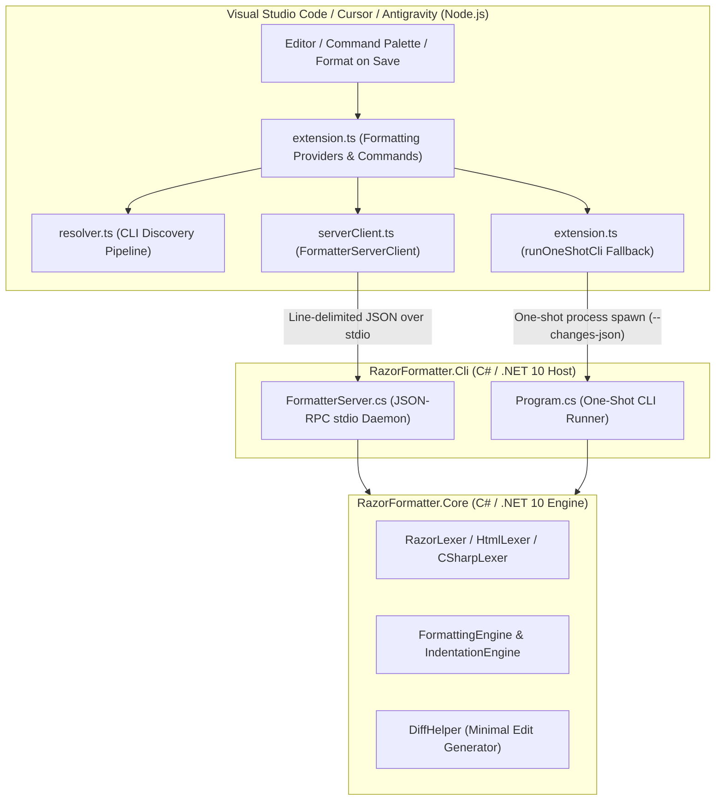
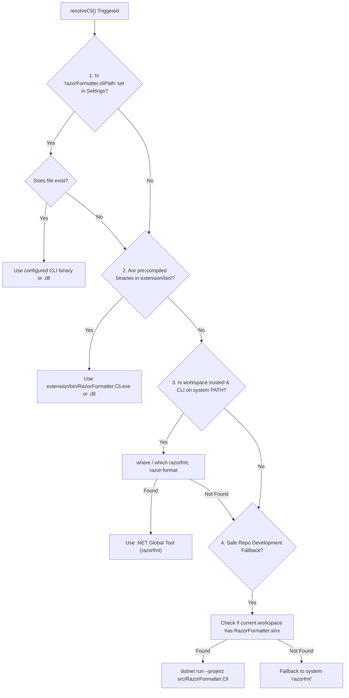

# VS Code Extension Architecture & Internal Design

This document provides a comprehensive technical breakdown of the **Razor Formatter** extension for Visual Studio Code, Cursor, and Google Antigravity (`razor-formatter.razor-code-formatter`). It details how the TypeScript extension interfaces with the .NET 10 core engine, the persistent background daemon architecture, the IPC protocol, executable discovery, and fault-tolerance mechanisms.

---

## 1. High-Level Architecture

The extension is designed around a decoupled, three-tier architecture:



### The Three Tiers

| Tier | Component | Technology | Responsibility |
|---|---|---|---|
| **Tier 1** | **VS Code Extension** | TypeScript / Node.js | Registers VS Code language formatting providers, tracks document lifecycle, handles user commands, manages process lifecycles, and converts byte-level diffs into `vscode.TextEdit` objects. |
| **Tier 2** | **CLI Daemon & Host** | C# (`net10.0`) | `RazorFormatter.Cli` acts as the execution bridge. When run with `--server`, it stays resident in memory as a background daemon, accepting line-delimited JSON requests over standard I/O (`stdin`/`stdout`). |
| **Tier 3** | **Core Formatting Engine** | C# (`net10.0`) | `RazorFormatter.Core` executes the actual lexing, tokenization, semantic indentation analysis, attribute wrapping, and minimal diff generation. |

---

## 2. Why a Persistent Background Daemon?

Running a .NET application from the command line (`dotnet run` or standalone binary) incurs two runtime penalties:
1. **OS Process Creation Overhead**: Spawning an external OS process requires thread setup and memory allocation.
2. **CLR & JIT Initialization**: The .NET Common Language Runtime must initialize, load core assemblies (`System.Runtime`, `System.Text.Json`), and JIT-compile methods on the first pass.

### Performance Comparison

```
┌────────────────────────────────────────────────────────────────────────┐
│ One-Shot CLI Execution: ~200 ms - 350 ms                               │
│ ├─ [CLR Boot & JIT: ~180-320 ms] ───┴─ [Format: ~5 ms] ───────────────┤
└────────────────────────────────────────────────────────────────────────┘

┌────────────────────────────────────────────────────────────────────────┐
│ Persistent Daemon Mode: < 5 ms                                         │
│ ├─ [IPC Stdio Transfer: ~1 ms] ─┴─ [In-Memory Format: ~2 ms] ─────────┤
└────────────────────────────────────────────────────────────────────────┘
```

- In **One-Shot Mode**, the user perceives a 200–350 ms lag during format-on-save, leading to noticeable UI stutter.
- In **Daemon Mode**, the daemon is pre-warmed once when the extension activates. All subsequent formatting operations complete in **under 5 ms**, enabling instant, flicker-free formatting even while typing.

---

## 3. Inter-Process Communication (IPC) Protocol

The communication between TypeScript (`serverClient.ts`) and C# (`FormatterServer.cs`) uses **Line-Delimited JSON (NDJSON)** over standard streams (`stdin` / `stdout`). No network ports, HTTP servers, or socket files are used, eliminating port conflict risks and firewall restrictions.

### 3.1 Handshake & Initialization

When TypeScript spawns `razorfmt --server`, the server immediately prints a handshake line to `stdout`:

```json
{"jsonrpc":"2.0","ready":true}
```

TypeScript awaits this message before marking the client as ready to accept format requests.

### 3.2 Formatting Request (`format`)

When a formatting edit is requested, TypeScript writes a single-line JSON string to `stdin`:

```json
{
  "id": 1,
  "method": "format",
  "params": {
    "text": "<div>\n@if (show) {\n<p>Hello</p>\n}\n</div>",
    "filePath": "/workspace/Components/Welcome.razor",
    "indentSize": 4,
    "indentStyle": "space",
    "endOfLine": "lf",
    "attributeLayout": "preserve"
  }
}
```

### 3.3 Formatting Response

The server processes the text through `IRazorFormatter` and outputs a matching JSON object referencing the request `id` on `stdout`:

```json
{
  "id": 1,
  "result": {
    "formattedText": "<div>\n    @if (show)\n    {\n        <p>Hello</p>\n    }\n</div>\n",
    "wasSkipped": false,
    "changes": [
      { "start": 6, "end": 6, "newText": "    " },
      { "start": 21, "end": 21, "newText": "\n    " },
      { "start": 23, "end": 23, "newText": "        " },
      { "start": 36, "end": 36, "newText": "    " }
    ],
    "diagnostics": []
  },
  "error": null
}
```

### 3.4 Supported RPC Methods

| Method | Parameters | Description |
|---|---|---|
| `initialize` | None | Returns server capabilities (`documentFormatting`, `rangeFormatting`, `documentCheck`). |
| `format` | `text`, `filePath`, `indentSize`, `indentStyle`, `endOfLine`, `attributeLayout` | Formats an entire document and returns minimal change deltas. |
| `formatRange` | `text`, `startOffset`, `endOffset`, options... | Formats a specific character span / selection. |
| `checkDocument` | `text`, options... | Dry-run check returning whether formatting is required (`needsFormatting: bool`). |
| `ping` | None | Health check returning `"pong"`. |
| `shutdown` / `exit` | None | Cleanly stops the background server and terminates the process. |

---

## 4. Minimal Diff Generation & Cursor Preservation

A naive formatter replaces the entire document (`new vscode.Range(0, 0, lineCount, colCount)`) with the formatted string. This causes critical usability issues:
- The user's cursor jumps to the top or bottom of the document.
- The editor view loses scroll position.
- VS Code's undo/redo history treats the entire document as deleted and re-inserted.
- Inline breakpoints, code lenses, and diagnostic squiggles flicker.

### How Razor Formatter Solves This

1. In `RazorFormatter.Core`, [`DiffHelper.ComputeTextChanges(original, formatted)`](file:///d:/user/Extensions/Ide/RazorFormatter/src/RazorFormatter.Core/FormattingEngine.cs) calculates the **Longest Common Subsequence (LCS)** diff between the original and formatted text.
2. The server outputs only the modified spans via `changes: [{ start, end, newText }]`.
3. In [`serverClient.ts`](file:///d:/user/Extensions/Ide/RazorFormatter/src/RazorFormatter.VSCode/src/serverClient.ts#L290), `convertResultToEdits` maps 0-based character offsets to `vscode.Position(line, character)`:

```typescript
function convertResultToEdits(document: vscode.TextDocument, result: ServerFormatResult): vscode.TextEdit[] {
    const edits: vscode.TextEdit[] = [];
    for (const ch of result.changes) {
        const startPos = document.positionAt(ch.start);
        const endPos = document.positionAt(ch.end);
        edits.push(vscode.TextEdit.replace(new vscode.Range(startPos, endPos), ch.newText));
    }
    return edits;
}
```

Because only modified whitespace and structural brackets are touched, the editor preserves the user's cursor position, selection range, and undo stack.

---

## 5. Executable Discovery Pipeline (`resolver.ts`)

When the extension activates, [`resolveCli()`](file:///d:/user/Extensions/Ide/RazorFormatter/src/RazorFormatter.VSCode/src/resolver.ts) locates the executable using a deterministic 4-stage resolution pipeline:



### Precedence Details

1. **User Setting (`razorFormatter.cliPath`)**: Highest priority. Allows developers or CI environments to point to an explicit custom build.
2. **Bundled Binaries (`extension/bin/`)**: Used when pre-packaged platform-specific binaries are distributed within the extension package.
3. **Global Tool on PATH (`razorfmt`)**: Discovers the tool installed via:
   ```bash
   dotnet tool install -g RazorCodeFormatter
   ```
4. **Local Repository Fallback**: If a developer is actively working inside the `RazorFormatter` source tree, the extension automatically invokes `dotnet run --no-build --project src/RazorFormatter.Cli/RazorFormatter.Cli.csproj`.

---

## 6. Fault-Tolerance & Resilience

The extension implements multiple safeguards to ensure that formatting failures never block or hang the editor:

### 6.1 Startup & Request Timeouts
- **Startup Timeout (5,000 ms)**: If the daemon fails to emit `{"ready": true}` within 5 seconds of launch, the promise rejects and logs a warning to the output channel.
- **Request Timeout (10,000 ms)**: Any format request that does not receive a response within 10 seconds is automatically aborted and evicted from the pending queue.

### 6.2 Cancellation Token Support
When a user types while formatting is underway, or switches documents, VS Code signals a `vscode.CancellationToken`. The extension immediately removes the pending request and cleanly cancels the operation without corrupting the editor buffer.

### 6.3 Automatic One-Shot Fallback
If the background server process crashes, experiences an unhandled exception, or fails to start, the extension does not fail silently. Instead, [`formatDocument()`](file:///d:/user/Extensions/Ide/RazorFormatter/src/RazorFormatter.VSCode/src/extension.ts#L250) logs a message and automatically falls back to **One-Shot CLI Execution** (`runOneShotCli`), which pipes the document directly into `razorfmt --changes-json` via standard input.

### 6.4 Auto-Restart on Next Request
If the daemon process terminates prematurely, `ensureRunning()` automatically spawns a fresh instance on the subsequent formatting request. Users can also manually restart the server at any time using:
> **Command Palette** (`Ctrl + Shift + P`) → `RazorFormatter: Restart Formatter Server`

---

## 7. Supported Commands & Capabilities

The extension registers the following user-facing commands in VS Code:

| Command ID | Title | Description |
|---|---|---|
| `razorFormatter.formatDocument` | `RazorFormatter: Format Document` | Formats the active `.cshtml` or `.razor` document buffer. |
| `razorFormatter.formatWorkspace` | `RazorFormatter: Format Workspace` | Scans the entire workspace for Razor files and formats them in batch with a progress dialog. |
| `razorFormatter.checkFormatting` | `RazorFormatter: Check Formatting` | Dry-run scan across all workspace Razor files, reporting any unformatted files in the Output Channel. |
| `razorFormatter.restartServer` | `RazorFormatter: Restart Formatter Server` | Disposes the current background daemon and spawns a fresh server instance. |

---

## 8. Security Architecture

1. **Workspace Trust Integration**: Executing binaries on the user's `PATH` or launching `dotnet run` requires an explicitly **Trusted Workspace** (`vscode.workspace.isTrusted`). In untrusted workspaces (e.g., untrusted cloned repositories), external tool execution is restricted to prevent arbitrary code execution.
2. **Machine-Scoped Path Setting**: The `razorFormatter.cliPath` configuration is strictly defined with `"scope": "machine"` in [`package.json`](file:///d:/user/Extensions/Ide/RazorFormatter/src/RazorFormatter.VSCode/package.json#L94). This prevents malicious repositories from bundling a rogue executable in `.vscode/settings.json` to exploit the user.
3. **No Shell Execution**: All process spawns explicitly specify `{ shell: false }`. Executables and arguments are passed as discrete token arrays, preventing shell injection vulnerabilities.

